# v0.8.9 — independent QA correction evidence

Captured from the actual application using live catalogs and original game artwork in [passing CI 43561382550](https://github.com/Avalon1230/avalon-azurlane/actions/runs/43561382550), implementation commit `b0685e7e7cb65a65e0050381ed09e15965ff8a1d`. All ten live desktop/mobile sessions passed without fixture catalog or image routing. Each session requires loaded profile, gallery and roster artwork. These captures supersede the earlier v0.8.9 evidence.

| Ship / identity | Desktop portrait | Mobile portrait | Desktop roster | Mobile roster |
| --- | --- | --- | --- | --- |
| Neptune — PR | 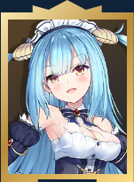 | 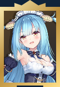 | 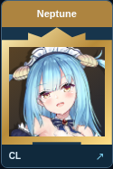 | 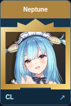 |
| Drake — DR | 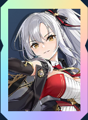 | 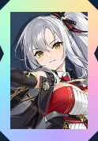 | 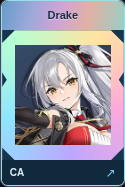 | 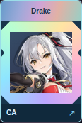 |
| Hunter META — Elite | 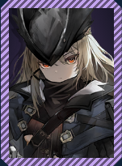 | 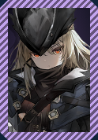 | 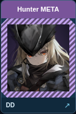 | 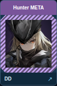 |
| Hiryuu META — Super Rare | 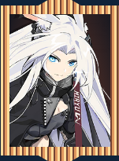 | 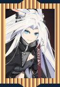 | 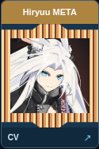 | 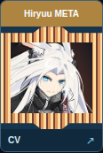 |
| Enterprise — ordinary | 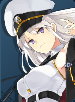 | 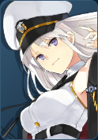 | 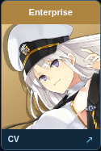 | 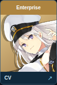 |

PR uses a raised crown and stepped feet; DR uses a beveled octagon with notched side rails. Elite META uses violet chamfered framing and background, while Super Rare META uses copper/gold rails, raised end caps and an ember background. META identity and rarity are checked against pinned source IDs, not names. Ordinary Enterprise retains its existing unornamented treatment. The CSS mask excludes the complete artwork rectangle; browser tests check the mask, padding, artwork bounds and distinct PR/DR outlines.

Desktop Equipment and Skills panels span the width below the summary, removing the long empty column below Sources. Full-width geometry is asserted for every desktop live session. Mobile remains one column. Portraits, roster crops and representative full desktop/mobile profiles were visually inspected. All screenshots are actual application captures, not generated artwork. Artwork rights remain with the game rights holders.

[All full profiles, portrait/roster crops and interaction screenshots](https://github.com/Avalon1230/avalon-azurlane/actions/runs/43561382550/artifacts/14100885833). Downloaded archive SHA-256: `350f1c17b71d50b0726a946ed6327c020e84fbf994dd8b63bd6335c429328e1e`.

Verification: 273 Node tests, 63 responsive cases, 10 combat sessions, four fixture research sessions, ten live-art sessions, syntax/generated-data and pinned combat/research/META source checks passed. Independent QA remains required; PR #32 is not merged. These checks do not establish game-battle performance.

---

## Historical v0.8.8 evidence

# Research portrait evidence

These are cropped **actual application screenshots**, captured by `scripts/research-interaction-smoke.mjs` in [CI 43332133024](https://github.com/Avalon1230/avalon-azurlane/actions/runs/43332133024) at implementation commit `09cf28a1ec303b659086a0beaa9e48facf3de770`. No mocked catalog or image routes were used for these two sessions. Full profiles and modal interaction captures are in that run's `research-ui-screenshots` artifact.

| PR Neptune, desktop 1280px | DR Drake, mobile 390px |
| --- | --- |
| 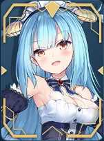 | 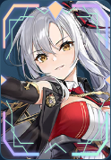 |

Portrait sources: [Neptune](https://raw.githubusercontent.com/iujab/azurlane-images/main/thumbnails/29901.png), [Drake](https://raw.githubusercontent.com/iujab/azurlane-images/main/thumbnails/29904.png). Official game artwork is hosted by a community mirror; artwork rights remain with the game rights holders. These small screenshots document QA appearance, not a reusable asset pack or a new artwork license. The original AVALON SVG ornaments are separate from the underlying portraits and contain no REGAL graphics.