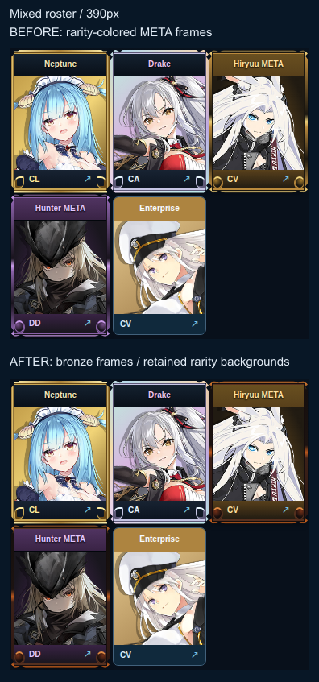
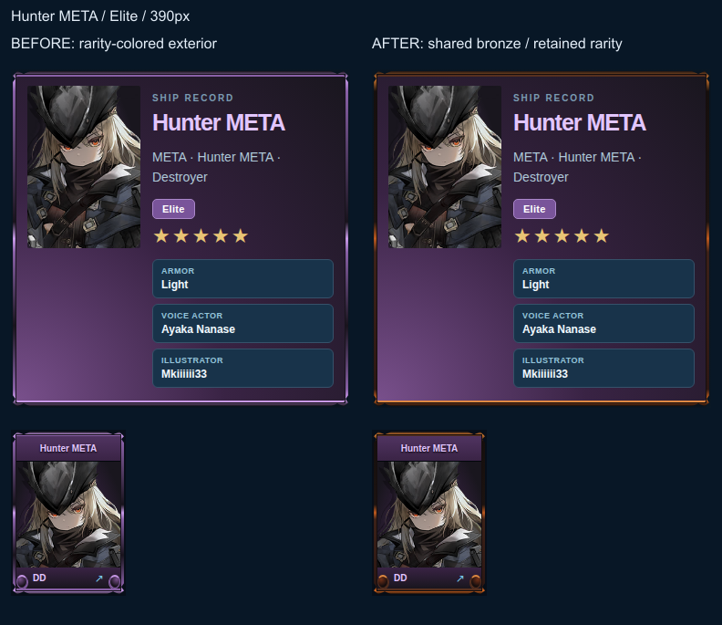
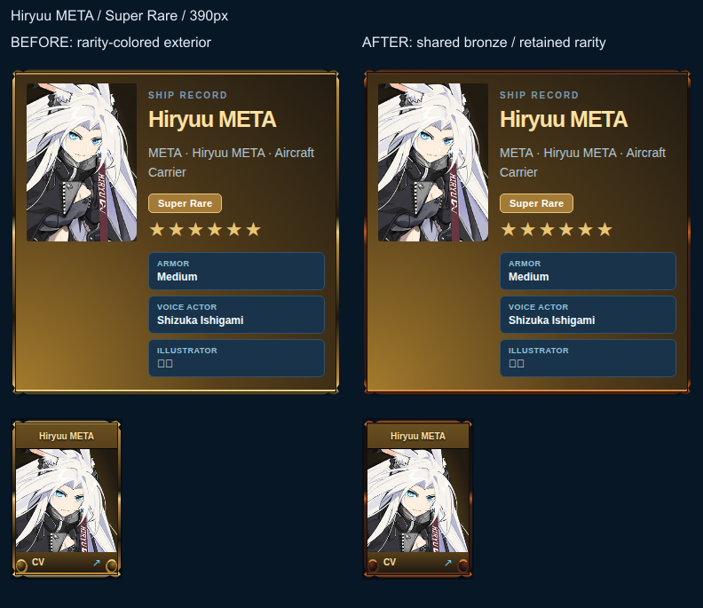

# v0.8.10 - unified META bronze frames

Baseline: `62da901c0f50941bc183ab4903580fb99cdc0469`.

The exterior communicates META identity. Elite and Super Rare share one scorched-bronze frame, rails and corner ornaments. The approved violet/charcoal Elite and dark-gold/amber Super Rare backgrounds and nameplates still communicate rarity.

## Actual application comparisons

| Subject | Desktop 1280px | Mobile 390px |
| --- | --- | --- |
| Hunter META / Elite, roster and hero | [Before/after](meta-elite-1280-comparison.png) | [Before/after](meta-elite-390-comparison.png) |
| Hiryuu META / Super Rare, roster and hero | [Before/after](meta-1280-comparison.png) | [Before/after](meta-390-comparison.png) |
| Mixed roster, five identities | [Before/after](mixed-1280-comparison.png) | [Before/after](mixed-390-comparison.png) |
| Current mixed roster | [Desktop](mixed-1280.png) | [Mobile](mixed-390.png) |

Screenshots use the actual application and live original artwork. Comparison sheets retain native screenshot pixels with labels and a neutral background. The mixed roster is the existing explicitly labeled test arrangement of unchanged production tiles in the production grid; it does not change normal nation grouping.

## Verification and visual inspection

Implementation `be8003e01f882126760c045d7917c6696e340a82` passed [CI 43673991053](https://github.com/Avalon1230/avalon-azurlane/actions/runs/43673991053): 282 Node tests, syntax/generated-data and pinned-source checks, 63 responsive cases, ten combat sessions, four research interaction sessions, ten current and ten baseline real-art sessions.

- Visually inspected all four before/after META roster/hero sheets and both mixed viewports: shared bronze framing, distinct violet/gold backgrounds, top names, large unobstructed artwork, stable proportions and no visible overlap.
- PR Neptune, DR Drake and ordinary Enterprise: all **12/12** decoded before/after roster/hero images are pixel-identical across both viewports.
- All eight META roster/hero captures retain identical dimensions. Interior pixel comparisons, excluding a 24px perimeter containing changed rails and corner ornaments, are identical. This is a scoped interior comparison, not a claim the complete META images are unchanged.
- Browser tests directly switch rarity on the same element and compare frame fill/silhouette, outer border, hero rails, footer rails and both corner ornaments. Exterior styles must match exactly; broad backgrounds must differ; card dimensions must remain equal.
- Source-ID classification tests include misleading ship names/display rarity. Name/footer contrast remains at least 4.5:1. Geometry, no portrait shrinkage, common nameplate order, long-name wrapping, persistence and combat/research checks pass.
- META remains static. No gameplay/state modules changed.

[Raw CI screenshot archive](https://github.com/Avalon1230/avalon-azurlane/actions/runs/43673991053/artifacts/14145830391), verified SHA-256: `726ca74b829a6e6fcee290eee994db47d366a8b01feaecc911bd3c914d974aa1`. Includes full application captures and PR/DR/ordinary controls.

The prior local-environment interruption is resolved for this pass. Independent visual QA and Commander merge authorization remain outstanding. **PR #33 is not merged.**
