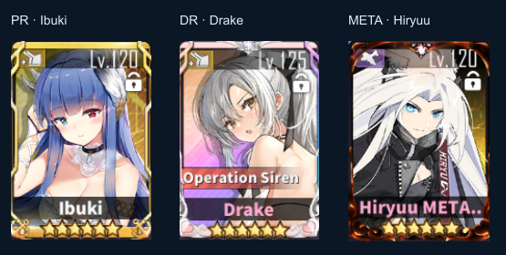
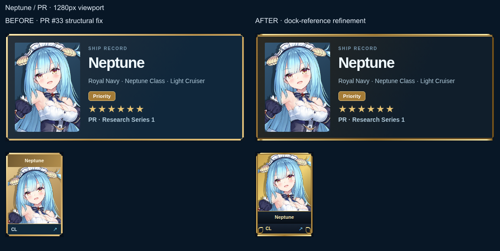
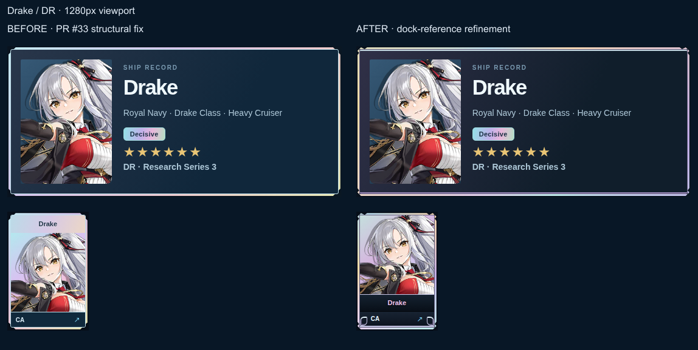
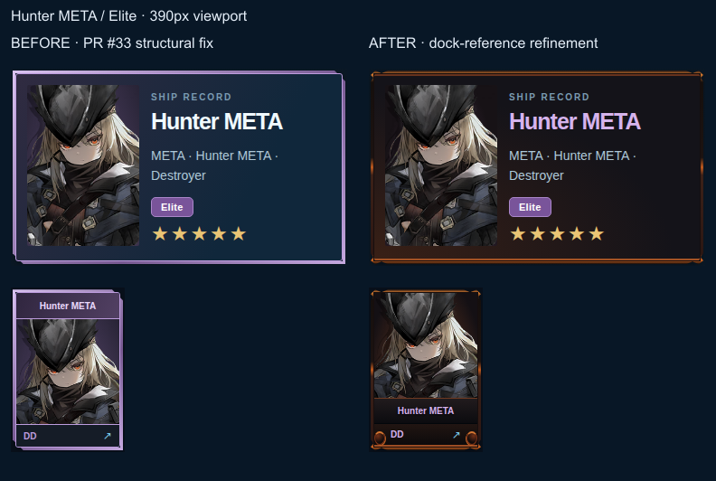
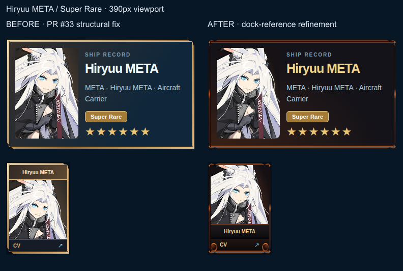

# v0.8.10 — dock-reference refinement

This follow-up uses the recovered in-game screenshots as its design reference. It retains PR #33's verified whole-card boundary and full-size artwork. The before column is PR head `df4a175165bf292c1c94c894405defd20b36cf91`; the after column is the dock-reference refinement. Earlier merged-v0.8.9 structural comparisons remain in [the historical evidence](../v0810/README.md).

## Recovered references

All three Commander-supplied files were visually inspected: `image(20261114-144552).png`, `image(20261114-144704).png`, and `download(3).png`. These selected crops retain their original pixels; labels and a neutral background were added for comparison.

| Observed in the references | Applied in AVALON | Deliberate boundary |
| --- | --- | --- |
| PR gold metal rails, shaped shoulders and small lower flourishes, visible on Ibuki/Mainz/Odin | Gold layered rail highlights, articulated exterior shoulders and small hull-rail end caps | Original AVALON CSS, not an extracted game frame asset |
| DR prismatic metal framing behind separate oath decoration, visible on Drake/Hakuryuu | Prismatic metal with a distinct articulated shoulder contour and lower detailing | White floral trim and top oath gems are excluded |
| Dark lower name band and art-led hierarchy | Special-card name and hull strips sit together below the full-size artwork | Name text stays clear of character artwork; no account stars/levels are fabricated |
| META blackened frames with orange/brown hot seams, dark curls and warm backing | Scorched dark/orange exterior rail, small dark lower end caps and warm portrait/hero backgrounds | Elite violet and Super Rare gold accents come from pinned rarity metadata, not visual inference |
| Oath, favorite, lock, fleet and activity overlays | None added as identity decoration | These represent separate account state |

META animation is **deferred**. The static ember finish establishes the identity without continuous effects across a mobile roster. There is no animation to suppress under reduced-motion settings. The game has animated frames according to the Commander; these still screenshots do not establish their timing or motion pattern. No exact asset or animation fidelity is claimed.

## Application comparisons

Each comparison contains an actual profile hero and roster tile, at native screenshot scale, before and after. All five identities are captured at desktop and mobile sizes using live catalogs and original game artwork. Screenshots include the exterior perimeter. Application pixels and artwork are not retouched.

| Classification | Desktop, 1280px | Mobile, 390px |
| --- | --- | --- |
| PR — Neptune | [Before / after](pr-1280-comparison.png) | [Before / after](pr-390-comparison.png) |
| DR — Drake | [Before / after](dr-1280-comparison.png) | [Before / after](dr-390-comparison.png) |
| META Elite — Hunter | [Before / after](meta-elite-1280-comparison.png) | [Before / after](meta-elite-390-comparison.png) |
| META Super Rare — Hiryuu | [Before / after](meta-1280-comparison.png) | [Before / after](meta-390-comparison.png) |
| Ordinary — Enterprise | [Before / after](ordinary-1280-comparison.png) | [Before / after](ordinary-390-comparison.png) |

Implementation `cae46d699c8fe80ade34b4b4b38b5059d4e220b1` passed [CI 43613168273](https://github.com/Avalon1230/avalon-azurlane/actions/runs/43613168273): 279 Node tests, 63 responsive cases, ten combat sessions, four research interaction sessions, ten current live-art sessions and ten pre-refinement baseline captures; syntax, generated-data and pinned-source checks passed. All ten before/after comparisons were inspected. Ordinary Enterprise hero and roster images are pixel-identical at 390px and 1280px. Artwork dimensions, exterior frame clearance, text separation and card heights pass browser assertions.

[Original screenshot archive](https://github.com/Avalon1230/avalon-azurlane/actions/runs/43613168273/artifacts/14121381668), SHA-256: `fc7b53e95655e4cc6908f52d236d99707797e3f15075fc8521d30492ce4a79c0`. Compared with the recovered dock references, the result uses lower name rails and restrained metallic research detailing, with a separate blackened ember treatment for META. It is an AVALON interpretation, not an exact replica. Independent visual QA and Commander approval remain required; PR #33 is not merged. Original game artwork rights remain with their respective rights holders; these are QA records, not a reusable artwork pack.
