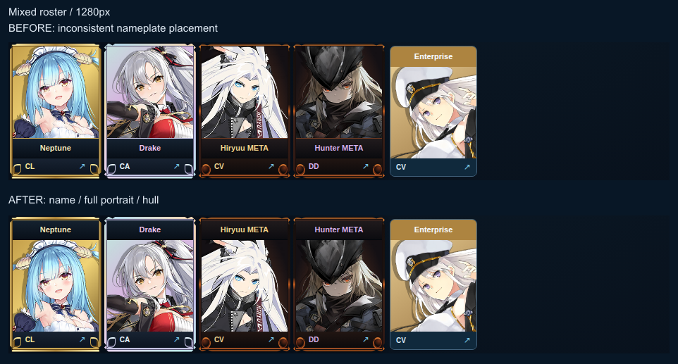
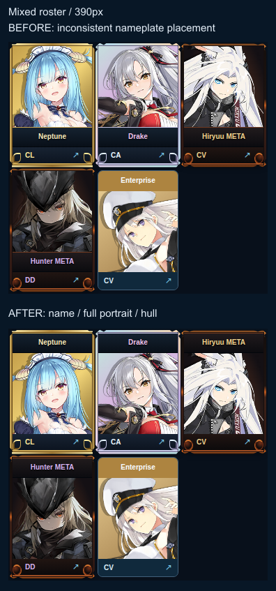

# v0.8.10 - consistent top nameplates

Starting head: `2cc2c5028d65f7085768ea6803141b4f817ebad3`.

Every roster card now follows **nameplate / artwork / hull**. Special cards inherit the same nameplate typography, spacing, alignment and wrapping as ordinary cards. Their dark/gold/prismatic/Elite/Super Rare colors remain, as do their whole-card frames and footer ornaments. The nameplate separators use inset shadows, preserving the ordinary nameplate's layout dimensions.

## Actual application evidence

These browser screenshots use unchanged production roster tiles collected from live application searches with loaded original artwork. A clearly labeled regression harness places Neptune (PR), Drake (DR), Hiryuu META (Super Rare), Hunter META (Elite), and Enterprise (ordinary) together in the production `.ship-gallery` grid. This is a focused test arrangement, not a new user-facing filter or a claim that the normal nation grouping was changed. No tile markup, artwork, styles or pixels are retouched.

| Viewport | Before / after | Current mixed roster |
| --- | --- | --- |
| Desktop 1280px | [Comparison](mixed-1280-comparison.png) | [Current](mixed-1280.png) |
| Mobile 390px | [Comparison](mixed-390-comparison.png) | [Current](mixed-390.png) |

## Verification

Implementation `9287778beb78eee39a4ec1643322b9fc9fdff8dc` passed [CI 43619881404](https://github.com/Avalon1230/avalon-azurlane/actions/runs/43619881404): 280 Node tests, syntax/generated-data and pinned-source checks, 63 responsive cases, ten combat sessions, four research interaction sessions, ten current live-art sessions and ten baseline sessions. Mixed-roster assertions passed at desktop/mobile; long unbroken names were also exercised across all five identities at 360, 390, 768 and 1280px.

- Browser checks verify names above portraits, hulls below, common nameplate metrics, consistent grid dimensions, no clipping/overflow, retained full-card frame clearance, and artwork dimensions relative to ordinary styling.
- All ten profile hero images (five identities at two sizes) are pixel-identical before/after. Both ordinary roster images are also pixel-identical.
- Both mixed-roster screenshots were visually inspected: the character artwork remains generous, names stay clear of faces, and each identity keeps its dock-inspired exterior.
- Research, Dev/Fate, acquisition tracking, six-slot loadouts, Fleet Lab and combat implementation modules are unchanged.
- META remains static; this correction adds no animation.
- [Raw CI screenshot archive](https://github.com/Avalon1230/avalon-azurlane/actions/runs/43619881404/artifacts/14123438628), SHA-256 `cbaf2a7352ccf77e0d73b5df9c1e7c49b2cc89886f43cfce832b5dff6c4a007e`. Includes full application/profile captures and individual roster cards in addition to these mixed comparisons.

The [recovered dock-reference study](../v0810-dock/README.md) remains historical design evidence. Its lower nameplate placement is superseded by the Commander's consistent-top-nameplate requirement. PR #33 remains unmerged, pending independent visual QA and Commander authorization.
