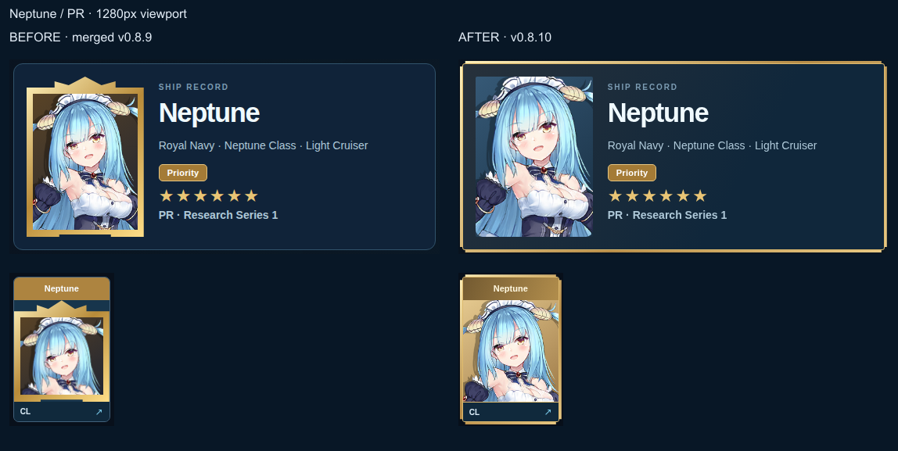
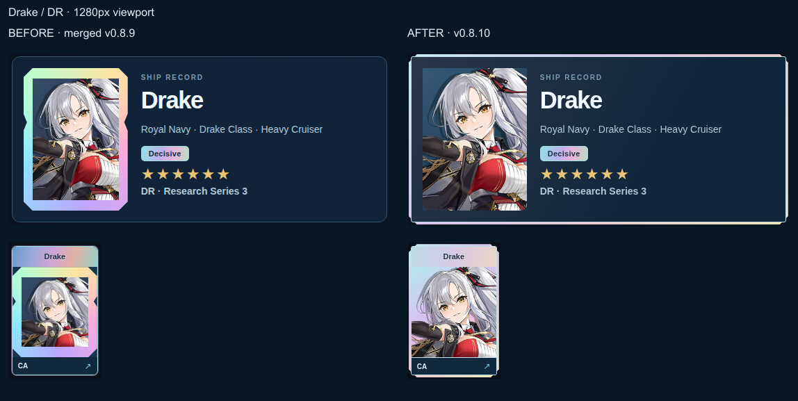
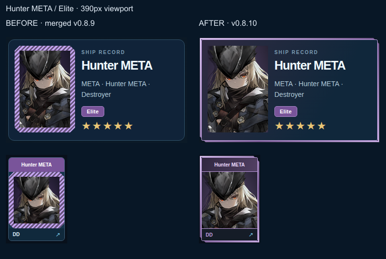
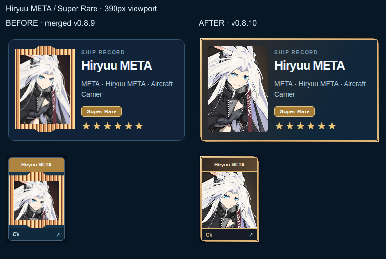

# v0.8.10 — whole-card visual comparison

Actual application screenshots, captured with live catalogs and original game artwork in [passing CI 43574972442](https://github.com/Avalon1230/avalon-azurlane/actions/runs/43574972442). **Before** is merged main `5445bc5763e4b7f30beb88840e8bc81d3a775714`; **after** is implementation `e09b55ed3a0d19cf6630552dffeb8133582355c6`. Each comparison places the complete profile hero above its roster tile, at native screenshot scale. Labels and side-by-side layout were added after capture; artwork and application pixels were not edited.

| Classification | Desktop, 1280px | Mobile, 390px |
| --- | --- | --- |
| PR — Neptune | [Before / after](pr-1280-comparison.png) | [Before / after](pr-390-comparison.png) |
| DR — Drake | [Before / after](dr-1280-comparison.png) | [Before / after](dr-390-comparison.png) |
| META Elite — Hunter | [Before / after](meta-elite-1280-comparison.png) | [Before / after](meta-elite-390-comparison.png) |
| META Super Rare — Hiryuu | [Before / after](meta-1280-comparison.png) | [Before / after](meta-390-comparison.png) |
| Ordinary — Enterprise | [Before / after](ordinary-1280-comparison.png) | [Before / after](ordinary-390-comparison.png) |

The new frame encloses name, artwork and hull footer on each roster tile, and the entire identity hero on profiles. The portrait itself no longer has an ornamental inset. The outer frame is out of flow, preserving card alignment and artwork area. PR has stepped gold corners, DR prismatic bevels, META asymmetric corners with violet Elite/gold Super Rare accents. Faces remain unobscured in the inspected captures. No game artwork was generated or replaced.

**Ordinary baseline:** decoded pixels of Enterprise's before/after hero and roster crops were compared and are identical at both viewports (four exact comparisons). Tests also require identity styling to preserve or increase artwork dimensions relative to ordinary styling, maintain card height, leave portrait padding at zero and attach the masked frame directly to the full card.

**Reference limitation:** the Commander's original in-game roster images could not be visually retrieved. Written requirements were recovered; two newer image records describe AVALON site screenshots. A direct image download attempt failed. Reattachment was requested. This is an original AVALON implementation of the explicit whole-card brief, not a claim of exact visual matching to unseen references. Independent QA must compare it against those references before acceptance.

**Verification:** 277 Node tests; syntax/generated-data and pinned combat/research/META source checks; 63 responsive cases; ten combat sessions; four research interaction sessions; ten current live-art sessions plus ten merged-baseline capture sessions passed. Existing Dev/Fate calculations, acquisition state, saved gear and six-slot loadouts remain unchanged. External collaboration logo hosts returned some HTTP 429 responses; all ten targeted ship-art cases loaded.

[Full current/baseline profiles, card crops and interaction screenshots](https://github.com/Avalon1230/avalon-azurlane/actions/runs/43574972442/artifacts/14106326855). Downloaded archive SHA-256: `4152432c012dfeb932e617269dbd14181b06dd85d40b382a57e5b8b44e527e06`.

Original game artwork rights remain with their respective rights holders. These are QA records, not an artwork asset pack. PR #33 remains unmerged; visual acceptance belongs to independent QA and Commander AVALON.
